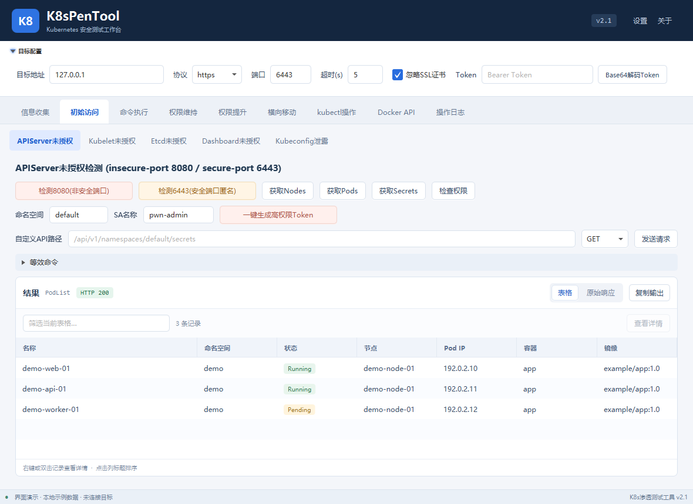
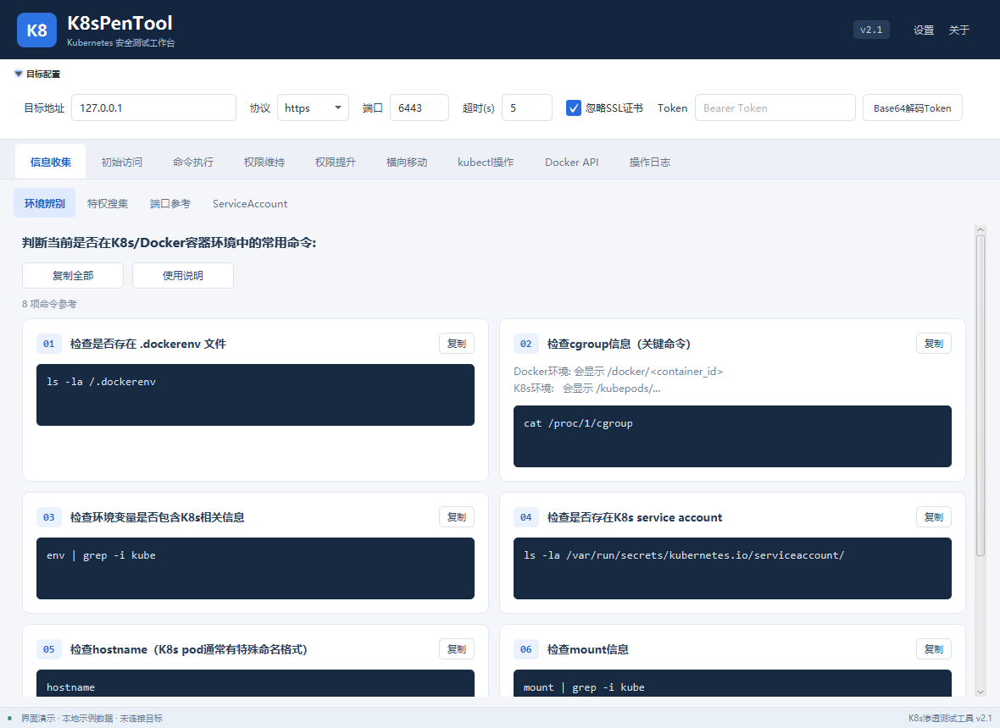
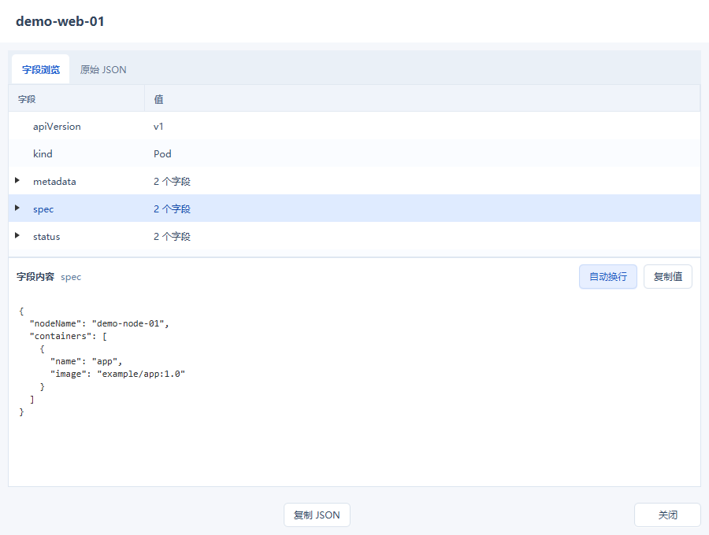
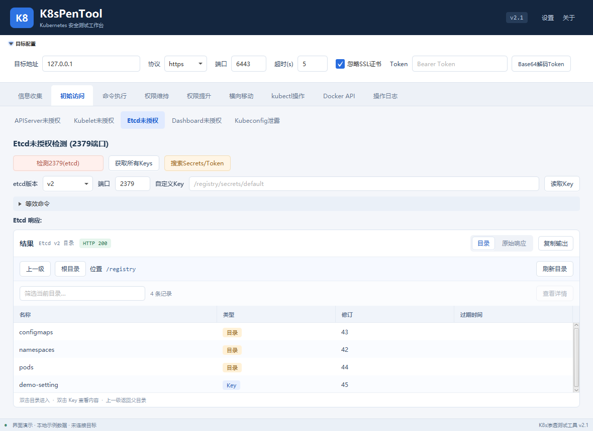
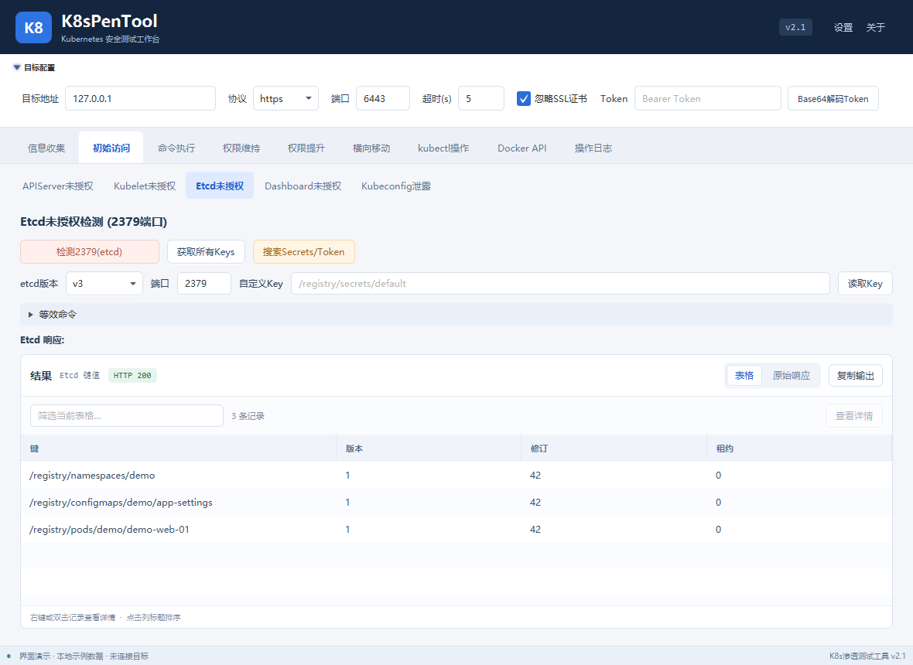
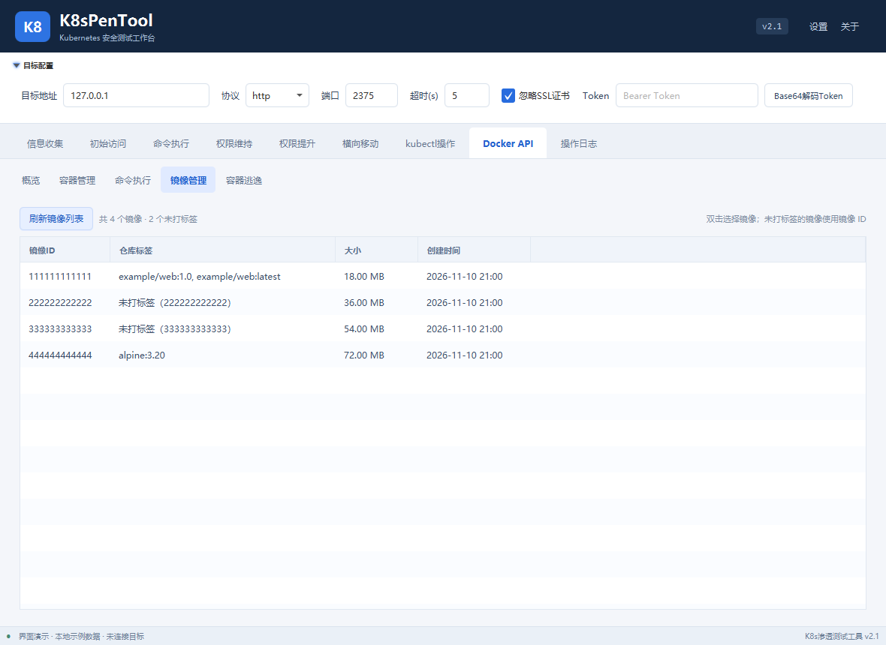
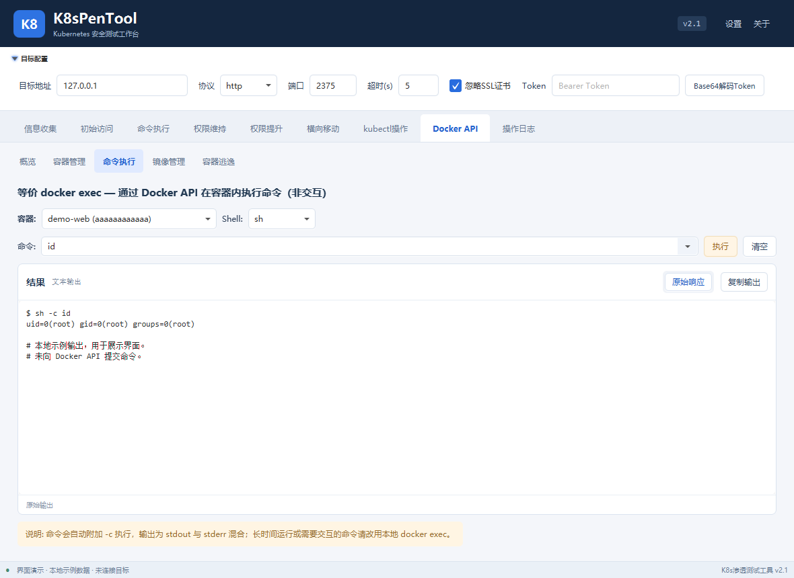
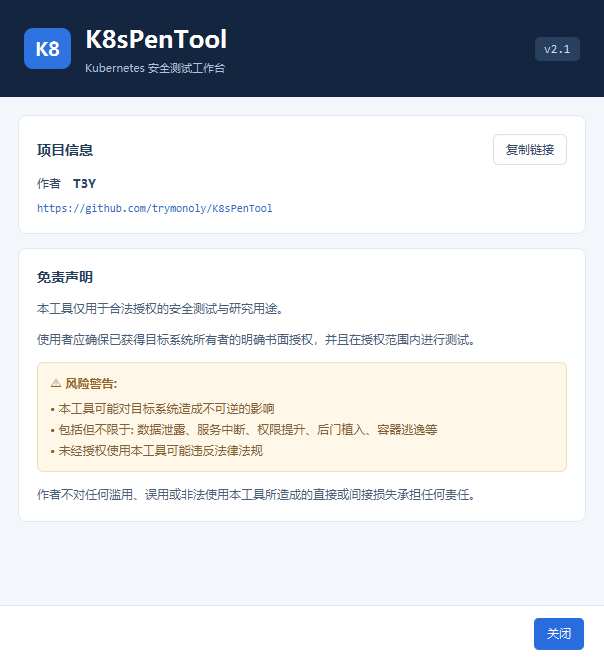

# K8sPenTool v2.1

> 基于 JavaFX 的 Kubernetes / Docker 安全测试 GUI 工具。

**作者：T3Y** · [下载 v2.1](https://github.com/trymonoly/K8sPenTool/releases/tag/v2.1)



## 简介

K8sPenTool 将信息搜集、初始访问、命令执行、权限维持、权限提升、横向移动、kubectl 和 Docker API 操作集成到统一界面中，面向已获授权的安全评估与研究场景。

## v2.1 更新

- **界面与屏幕适配**：重做工作台、两级导航和关于页面；启动窗口按屏幕可用尺寸调整，修复目标配置行裁切、控件对齐和结果区空间不足的问题。
- **结构化结果**：JSON 和支持的 kubectl 列表输出可用表格查看，提供数量统计、筛选、排序、状态标识、右键操作及原始响应视图；Pod 列表支持点击回填参数。
- **完整字段详情**：字段树与独立内容区配合展示，长文本可滚动、自动换行和复制，保留原始 JSON，解决多行内容在单元格内显示不全的问题。
- **Etcd v2 目录浏览**：按当前层级展示目录和 Key；双击目录进入，支持上一级、根目录和刷新目录，双击 Key 查看内容，兼容中文及需要 URL 编码的路径。
- **Etcd v3 Key 解码**：Key 默认显示 Base64 解码后的可读文本，筛选和复制使用解码结果；详情保留原始 Base64，无法解码为可读 UTF-8 文本时保留原值。
- **Docker API 模块**：提供概览、容器管理、非交互命令执行、镜像管理和容器检查；复用顶部目标地址、协议、端口及超时配置。
- **Docker 镜像与空值修复**：未打标签的镜像显示短 ID，选择和双击回填使用完整镜像 ID；处理空标签、重复标签、`<none>`、空容器名称和空挂载列表，避免将 `-` 等占位符提交为镜像名。
- **命令与参考内容**：命令输入支持可编辑下拉；清理终端 ANSI 控制序列以改善输出阅读；参考命令改为分步卡片，长文档改用独立阅读窗口；挂载目录默认使用 `/peninfo`。

## 功能模块

| 模块 | 说明 |
| --- | --- |
| 信息搜集 | 容器环境辨别、特权检测、Capabilities 解码、端口参考与扫描、ServiceAccount 信息 |
| 初始访问 | APIServer、Kubelet、Etcd、Dashboard 检测与 Kubeconfig 解析 |
| 命令执行 | APIServer / Kubelet exec、Pod 操作、ServiceAccount 使用、RBAC 检测与命令生成 |
| 权限维持 | ServiceAccount、CronJob / DaemonSet、Kubeconfig 和宿主机持久化相关操作 |
| 权限提升 | 特权容器、挂载与内核相关检查和参考命令 |
| 横向移动 | Secret 信息、内网探测与 Pod 调度相关操作 |
| kubectl 操作 | 快捷命令、自定义命令、Pod 管理 |
| Docker API | 概览、容器列表与生命周期操作、创建容器、exec、镜像管理和挂载检查 |
| 操作日志 | 请求、执行状态和错误信息 |

## 下载与运行

当前发布包面向 **Windows x64**，需要 **JDK 17**；项目内嵌 Windows 版 `kubectl.exe`。

1. 从 [v2.1 Release](https://github.com/trymonoly/K8sPenTool/releases/tag/v2.1) 下载 `k8s-pen-tool-2.1.jar`。
2. 确认 `java -version` 为 Java 17，再运行：

```powershell
java -jar .\k8s-pen-tool-2.1.jar
```

如果 PATH 中的 Java 版本较旧，可使用 JDK 17 的完整路径：

```powershell
& "$env:JAVA_HOME\bin\java.exe" -jar .\k8s-pen-tool-2.1.jar
```

Release 同时提供 `SHA256SUMS.txt`，可用 PowerShell 的 `Get-FileHash` 核对 JAR：

```powershell
Get-FileHash .\k8s-pen-tool-2.1.jar -Algorithm SHA256
```

## 从源码构建

依赖 **JDK 17** 与 **Maven 3.6+**；主要组件为 JavaFX 17.0.2、Gson 2.9.0 和 Maven Shade Plugin。

```powershell
git clone https://github.com/trymonoly/K8sPenTool.git
cd K8sPenTool
mvn clean package
java -jar .\target\k8s-pen-tool-2.1.jar
```

开发时也可以使用 `mvn javafx:run`。

## 使用说明

- 在顶部配置目标地址、协议、端口、超时和 Token。APIServer 常用 `https / 6443`，Docker Remote API 常用 `http / 2375`。
- Docker API 使用顶部目标配置；HTTPS 尚未实现客户端证书认证。Docker exec 为非交互执行，界面展示 stdout 与 stderr 的合并输出。
- Etcd 在模块内选择 `v2` 或 `v3` 并设置 Etcd 端口。v2 中双击目录进入，使用“上一级 / 根目录”导航；双击 Key 查看完整内容。目录筛选只针对当前层级。
- 结果表格支持右键或双击查看详情。详情中的“复制值”复制完整字段内容，“原始 JSON”保留响应数据。
- 命令下拉列表只负责填入命令，可继续编辑，再点击“执行”。

## 界面预览

以下图片均为 **v2.1 实际 UI 内容快照**，仅包含工具界面。示例资源和输出由本地演示数据填充，未连接真实目标，不代表真实集群检测结果。

| 命令参考卡片 | 资源详情与完整字段内容 |
| --- | --- |
|  |  |

| Etcd v2 目录浏览 | Etcd v3 可读 Key |
| --- | --- |
|  |  |

| Docker 镜像管理 | Docker 命令输入与输出 |
| --- | --- |
|  |  |

<details>
<summary>关于与免责声明界面</summary>



</details>

## 项目结构

```text
K8sPenTool/
├── pom.xml
├── README.md
├── img/v2.1/                        # 当前版本 UI 截图
├── src/main/java/
│   ├── module-info.java
│   └── com/k8spen/tool/
│       ├── Main.java / Launcher.java
│       ├── controller/              # 主控制器、共享上下文与模块 Handler
│       ├── helper/                  # Pod / Secret / Docker 数据模型及解析
│       ├── utils/                   # HTTP、JSON、kubectl 与 Docker API 工具
│       └── view/                    # 结果表格、字段详情、命令卡片与文章窗口
└── src/main/resources/
    ├── gui.fxml
    ├── workspace.css
    └── kubectl.exe
```

---

## ⚠️ 风险警告

本工具包含的功能可能对目标系统造成**不可逆的影响**，包括但不限于:

- 🔴 **数据泄露** — 读取 Secret、Token、Kubeconfig 等敏感信息
- 🔴 **服务中断** — 部署/删除 Pod、DaemonSet 等可能影响业务
- 🔴 **权限提升** — 创建 cluster-admin 服务账号、植入后门
- 🔴 **容器逃逸** — 利用特权容器或内核漏洞逃逸到宿主机
- 🔴 **横向移动** — 利用窃取的凭证扩大攻击面

## 📜 免责声明

1. **本工具仅用于合法授权的安全测试与研究用途。**
2. 使用者应确保已获得目标系统所有者的**明确书面授权**，并在授权范围内进行测试。
3. **严禁**将本工具用于任何未经授权的渗透测试、攻击或其他非法活动。
4. 作者 **T3Y** 不对任何滥用、误用或非法使用本工具所造成的直接或间接损失承担任何责任。
5. 使用本工具即表示您已阅读并同意以上声明，所有后果由使用者自行承担。

## License

MIT License

---

<p align="center">
  <b>K8sPenTool</b> — Made with ☕ by <b>T3Y</b>
</p>
